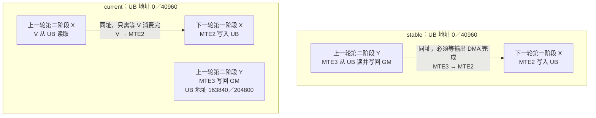

# RMSNorm `x5-weight5`：PlanMemory 与 GraphSyncSolver 差异

分析日期：2026-10-13。对象：`_rmsnorm_fwd_kernel`，`test_rmsnorm_forward_backward_diff[x5-weight5]`。以下 stable/current 均使用各自的 `bishengir-compile`，同一份输入 `.bcmlir`；重放所得目标文件与相应版本原始 `.npubin` 字节一致。完整日志在同目录 `stable_all-ir.mlir`、`current_all-ir.mlir`；调试摘录在 `/home/m00953828/mojo/mojo_data/rmsnorm_x5_planmemory_analysis_20261013/{stable,current}/`。

## 结论先行

两版输入相同、autotune 未变化。前两次 PlanMemory 输出相同；第三次输入仍相同，但 UB 地址布局不同。此处**不是** planning policy 切换造成的：stable 在 `attempt 1/9` 成功；current 也只进行一轮规划并成功，`hivm.multi_buffer = 2` 保留，两版均未走 remove-MultiBuffer / disable-VF-reachable-check 后备 policy。调试显示 current 的 optional inplace 边为 0，因此这次差异主要来自 StorageEntry 的 DSATUR 顺序与旧顺序不同，再由相同的 first-fit / MultiSpec 规则落实为不同地址。

GraphSyncSolver 源码会根据 `pointer_cast` 的物理地址和分配大小判断内存区间冲突（`MemInfo.cpp` 的 `PointerLikeInfo::checkConflict`）；其源码在本次 stable/current 分支对比中没有变化。因此地址布局改变能够改变同步依赖。实际输出确实不同，但**current 的同步数量并未减少**：stable 为 20 `wait_flag`、20 `set_flag`、2 `pipe_barrier`；current 为 21、21、3。性能提升不能简单归因于“同步更少”。

## 从 PlanMemory 看，为什么这个布局可能更快

这里决定性能的不是最终占用字节数，而是**把哪两块 buffer 安排到同一个地址**。两版第一阶段 X tile 均在 UB 地址 `(0,40960)`。stable 的第二阶段 Y tile（由 V 生成，交给 MTE3 写回 GM）也占 `(0,40960)`；current 把第二阶段 X tile（由 MTE2 加载，交给 V 消费）放在这个地址，把 Y tile 移到 `(163840,204800)`。

图中箭头只表示**因这组 UB 地址复用而产生的跨迭代依赖**；current 的 MTE3 仍可能受其他同步约束，不能把未连线理解为整个 kernel 中两条流水线完全独立。

这直接改变了跨外层循环迭代的依赖：stable 在下一轮第一阶段 X 的 MTE2 load **之前**有 `wait_flag<MTE3,MTE2,EVENT_ID0>`，上一轮第二阶段结束处对应 `set_flag<MTE3,MTE2,EVENT_ID0>`。由于上一轮 Y 的 MTE3 store 与下一轮 X 的 MTE2 load 共用 UB 地址，必须先确保 store 不再读取该地址。也就是下一轮输入 DMA 等上一轮输出 DMA。

current 不再让 Y 与下一轮 X 共址，因而这一对 `MTE3 → MTE2` 同步消失。相同位置改为 `wait_flag<V,MTE2,EVENT_ID0>` / `set_flag<V,MTE2,EVENT_ID0>`：复用地址上的前一个 X 只须等 V 消费完，再允许 MTE2 写入。这使下一轮输入加载不再被上一轮输出写回直接挡住，**可能允许 MTE2 与仍在进行的 MTE3 更好地重叠**。这就是从 PlanMemory 地址选择到潜在性能收益的具体链条。

但这不是无代价的改善：current 同时在 fused VF 前增加 `MTE3 → V` 等待，并多一个 MTE3 barrier。故不能声称整个依赖图一定更短、或已证明 3.34% 全由上述一条边贡献。现有 IR 能证明地址复用对象及同步依赖从 `MTE3 → MTE2` 变为 `V → MTE2`；其实际运行时收益还需性能计数器或控制变量实验确认。

## 1. policy 与输入检查

- 四份输入 `.bcmlir` 的 SHA256 一致；该 kernel 不使用 `@triton.autotune`，使用固定的 `BLOCK_SIZE_N` 和 `@triton.heuristics`。
- stable/current 的第三次 `IR Dump Before PlanMemory` 完全一致（224 行）。用两版 `bishengir-opt --hivm-plan-memory-regbase --debug` 单独重放该 IR，结果分别与原编译器的第三次 PlanMemory 输出一致（忽略警告/尾部空行）。
- stable 调试日志只见 `Memory planning attempt 1/9`，随后成功；current 只见一次 DSATUR 建图/排序，随后成功。`hivm.multi_buffer = 2` 在两版输出中仍存在。故此次两版是同一档顶层 policy；不能把变化解释成清理 MultiBuffer 或关闭 VF 可达性检查。
- current 图为 14 个节点、9 个 group、`optionalInplaceEdges=0`；两版存在相同的必需 alias pair。这里没有 optional inplace 搜索选择的差异。

注意：上述结论只针对这个 kernel 和这次重放；其他 case 仍需逐例核对 policy。

## 2. PlanMemory 实际改了什么

第三次 PlanMemory 的计算/访存操作未改变；`after` 的差异是 UB `pointer_cast` 使用的物理地址常量。下表均以字节计，每个大 tile 为 `10240 × f32 = 40960 B`，括号内为两个 MultiBuffer 槽位。

| buffer（按 IR 中操作辨认） | stable 地址 | current 地址 |
| --- | --- | --- |
| 第一阶段归约：从 `%arg4` 加载的 X tile | (0, 40960) | (0, 40960) |
| 第二阶段归一化：从 `%arg4` 加载的 X tile | (81984, 122944) | (0, 40960) |
| 第二阶段归一化：从 `%arg6` 加载的 W tile | (163904, 204864) | (81920, 122880) |
| 第二阶段归一化：VF 生成、向 `%arg2` 存储的 Y tile | (0, 40960) | (163840, 204800) |
| 第二阶段标量 MultiBuffer | (81920, 81952) | (245760, 245792) |

因此：stable 让第一阶段 X 与第二阶段 Y 共用地址；current 让第一阶段 X 与第二阶段 X 共用地址。第二阶段的 X/W/Y 在两版里彼此不重叠。stable 的第二阶段 X、W 起始地址还被标量块推后 64 B；current 四组大 tile 优先排布，从 40960 B 边界起始。总体尾部容量没有显著降低，不能把收益归因为 UB 峰值下降。

两版的无复用最高 spec 尝试均因容量失败，然后走复用/多档规划；都仅有两个大 entry 退到 spec level 2，其余成功于 level 3。旧版日志中 256-bit 标量 entry 插在部分 327680-bit tile entry 前；current DSATUR 先选四个 655360-bit 的 MultiBuffer group，再处理小 group。这使 first-fit 的早期占位不同，进而决定上表的地址复用关系。

## 3. GraphSyncSolver 实际改了什么

比较第一次针对 `func.func @_rmsnorm_fwd_kernel` 的 `IR Dump After GraphSyncSolver`，忽略 SSA 编号重命名，可见：

1. stable 的外层循环有 `MTE3 → MTE2` 的 event0 配对；current 用 `V → MTE2` 的 event0，并增加 `MTE3 → V` 的 event3。这是依赖拓扑变化，不是单纯 event 编号重排。
2. current 在第一阶段归约循环之后、随后 fused VF 之前增加 `wait_flag<MTE3,V>`；在第一阶段标量 store 前还增加 `pipe_barrier<MTE3>`，并在 store 后设置相应 `MTE3 → V` flag。stable 这几个位置没有相同同步。
3. 第二阶段大 tile 的 `MTE2 → V`、`V → MTE3` 依赖在两版都存在；地址变化主要改变跨阶段的复用关系与相应同步连接。

机制上，GraphSyncSolver 的内存冲突检测读取 PlanMemory 给出的 `pointer_cast` 地址，遇到同一 address space 且区间相交时建立冲突，再安排同步。上述地址关系变化与同步拓扑变化吻合。**但仅凭 IR 不能量化是哪一条同步或哪一种地址对齐带来了约 3% 性能收益**；current 甚至多一组 flag 和一个 barrier。也可能涉及不同依赖路径带来的流水重叠、地址对齐/访存行为，或测量因素。要证明具体硬件原因，需要进一步对比最终指令序列或 profile，并做控制变量实验。

## 4. 性能证据与边界

已有两轮性能：stable 902.428、905.382 µs；current 866.759、880.719 µs。均值 stable 903.905 µs，current 873.739 µs，缩短约 30.166 µs（3.34%）。在相同输入/同档 policy 前提下，PlanMemory 第三次输出变化及后继同步差异是明确的编译链路变化；“同步更少”不是解释。

可复核位置：同目录两个 `*_all-ir.mlir`；`/home/m00953828/mojo/mojo_data/rmsnorm_x5_planmemory_analysis_20261013/{stable,current}/planmemory_before_3.mlir`、`planmemory_after_3.mlir`、`graphsync_after_fwd.mlir`、`opt-debug.log`。本记录不把 `.npubin` 差异当作独立的 PlanMemory 证据，而是使用对应 pass 的输入/输出 IR。
