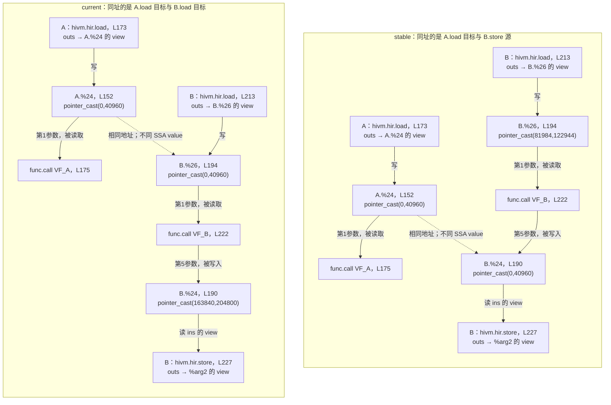

# RMSNorm x5-weight5：基于 IR 的 PlanMemory 输出变化

对象：`_rmsnorm_fwd_kernel`，`test_rmsnorm_forward_backward_diff[x5-weight5]`。日期：2026-10-13。

**主要变化：stable 把循环 A 的 load 目标与循环 B 的 store 源 buffer 分配到相同 UB 地址；current 把循环 A、B 的两个 load 目标分配到相同 UB 地址。** 地址复用对象改变后，GraphSyncSolver 在循环 A 之前插入的等待也发生变化。这是本例最有 IR 依据的性能收益解释。

## 1. 先在 IR 中定位循环和 buffer

本文件以第三次 PlanMemory 的输出为准。前两次为 GM workspace 规划；第三次为本地内存规划。两版第三次输入一致，以下操作的结构和参数关系也一致。

在 `func.func @_rmsnorm_fwd_kernel` 中，`scf.for %arg16` 的 body 包含两个顺序出现的 `%arg17` 循环。为了区分作用域，本文定义：

| 本文名称 | 对应的真实 IR | PlanMemory 输出行号 |
|---|---|---:|
| 外围循环 R | `scf.for %arg16 = %9 to %arg8 step %arg12` | 139 |
| 循环 A | `%19 = scf.for %arg17 ... iter_args(%arg18 = %4)` | 151 |
| 循环 B | `scf.for %arg17 ...`，没有 iter_args | 189 |
| VF_A | `@_rmsnorm_fwd_kernel_fused_0_outlined_vf_0` | 调用在 175 |
| VF_B | `@_rmsnorm_fwd_kernel_outlined_vf_4` | 调用在 222 |

`A.%24` 和 `B.%24` 是**不同循环作用域内的两个不同 SSA value**；`A.`、`B.` 是本文加的定位前缀，不属于 IR 语法。本文不通过业务上的“行、X、Y”解释图示，均使用这些操作和值定位。

原始输出：[stable PlanMemory](/home/m00953828/mojo/mojo_data/rmsnorm_x5_planmemory_analysis_20261013/stable/planmemory_after_3.mlir:139)、[current PlanMemory](/home/m00953828/mojo/mojo_data/rmsnorm_x5_planmemory_analysis_20261013/current/planmemory_after_3.mlir:139)。

## 2. PlanMemory 主要改变了哪些地址

地址单位为 **B（字节）**。每个大 buffer 的一个槽位为 `10240 × sizeof(f32) = 40960 B`；表中两个地址对应 `hivm.multi_buffer = 2` 的两个槽位，实际执行时轮换使用，不是一次 load 同时写两个槽位。

| buffer | 通过 IR 操作确认的用途 | stable 地址 | current 地址 |
|---|---|---|---|
| `A.%24`，L152 | L173 `hivm.hir.load` 的 outs 经 view 指向它；L175 VF_A 的第 1 个参数 | `(0,40960)` | `(0,40960)` |
| `B.%26`，L194 | L213 `hivm.hir.load` 的 outs 经 view 指向它；L222 VF_B 的第 1 个参数 | `(81984,122944)` | `(0,40960)` |
| `B.%25`，L192 | L221 另一条 `hivm.hir.load` 的 outs 经 view 指向它；L222 VF_B 的第 2 个参数 | `(163904,204864)` | `(81920,122880)` |
| `B.%24`，L190 | L222 VF_B 的第 5 个参数；L227 `hivm.hir.store` 的 ins 经 view 指向它 | `(0,40960)` | `(163840,204800)` |
| `R.%10`，L140 | L180 `fused_2` 的第 4 个参数；L185 标量 `hivm.hir.store` 的源，L187 `memref.load` 的源 | `(81920,81952)` | `(245760,245792)` |

scalar/scratch 的其他地址也有调整，但核心是前四组大 buffer 的复用关系。两版最后的最高 `pointer_cast` 起始地址都为 245920 B，不能用“UB 整体容量明显减少”解释本例收益。

## 3. 图示：直接画 op 和它访问的 UB buffer

图中**实线表示 buffer 的读写关系**，不是硬件执行完成的时间顺序；**虚线只表示两组 pointer_cast 的物理地址相同**。为了突出主要变化，图中省略 `B.%25`、标量 buffer 和 subview/collapse_shape 的中间节点。VF_A、VF_B 的全名见第 1 节。



读图时关注虚线的另一端：stable 连接 `B.%24`，current 连接 `B.%26`。这就是 PlanMemory 的主要输出变化。

VF_B 的读写方向可直接在函数定义中确认：L94 的 `vector.transfer_read` 读取第 1 个参数的 view，L99 的 `vector.transfer_write` 写第 5 个参数的 view，见 [VF_B 定义](/home/m00953828/mojo/mojo_data/rmsnorm_x5_planmemory_analysis_20261013/stable/planmemory_after_3.mlir:83)。不是仅凭参数排列猜测读写。

## 4. 用真实 SSA 链核对图示

下面是 PlanMemory 输出的缩写摘录，省略类型和不影响定位的属性；`A.%24` 等前缀仅用于本文定位，这些片段不是可直接执行的 MLIR。

两版循环 A 的大 buffer 地址相同：

```mlir
// 循环 A：L152、L171～175
A.%24 = hivm.hir.pointer_cast(%c0_i64, %c40960_i64)
%subview_3 = memref.subview A.%24 ...
%collapse_shape_4 = memref.collapse_shape %subview_3 ...
hivm.hir.load ins(%subview_2) outs(%collapse_shape_4)
func.call @_rmsnorm_fwd_kernel_fused_0_outlined_vf_0(A.%24, %36)
```

循环 B 的两处关键变化：

```mlir
// stable：L190、L194
B.%24 = hivm.hir.pointer_cast(%c0_i64, %c40960_i64)
B.%26 = hivm.hir.pointer_cast(%c81984_i64, %c122944_i64)

// current：同样是 L190、L194
B.%24 = hivm.hir.pointer_cast(%c163840_i64, %c204800_i64)
B.%26 = hivm.hir.pointer_cast(%c0_i64, %c40960_i64)

// 两版相同的访问链：L212～227
%subview_3 = memref.subview B.%26 ...
hivm.hir.load ins(%subview_2) outs(%subview_3)
func.call @_rmsnorm_fwd_kernel_outlined_vf_4(B.%26, %25, %arg11, %22, B.%24)
%subview_8 = memref.subview B.%24 ...
hivm.hir.store ins(%subview_8) outs(%subview_9)
```

stable 在 `R` 的后续迭代重新进入 A 时，A 的 load 会写到 B 的 store 还可能正在读取的地址。current 中，A 的 load 使用的地址由 VF_B 读取，而 B 的 store 读取的是另一区间。两种布局对“谁完成之后才能重写 0/40960”给出了不同答案：stable 需要考虑 MTE3 的读取完成，current 需要考虑 V 的读取完成。

## 5. DSATUR 怎样使这个结果变化

本例没有最终可用的 optional inplace 合并：current 日志 L454 为 `optionalInplaceEdges=0`。虽然 VF 复用分析打印过候选，后续合法性检查拒绝了相应的大 buffer 合并：VF_B 的第 5 个参数可达 `PIPE_MTE3`，第 1、2 个参数可达 `PIPE_MTE2`。所以这次变化不是 optional inplace 选了不同的合并方案。必需的 alias 处理仍存在。

DSATUR 对 **StorageEntry 的规划顺序**起作用；两版后续都使用 first-fit 和 MultiSpec。这里需要区分：**两个独立 SE 最终分到同一物理地址，不等于它们被 optional inplace 合并成一个 SE。**

current 建图得到 14 个节点、9 个 group。四组大 buffer 都有两个 MultiBuffer 槽位，每组实际大小 81920 B。日志中的 `groupBytes=655360` 数值在本例是两槽位的 bit 数，换算为 81920 B，不能直接理解成 655360 字节。

大 group 的选取顺序如下，来自 [current 排序日志](/home/m00953828/mojo/mojo_data/rmsnorm_x5_planmemory_analysis_20261013/current/opt-debug.log:454)：

| DSATUR step | group | 对应本文件的 buffer | liveTicks | reuseCandidateCount |
|---:|---:|---|---:|---:|
| 0 | 1 | `B.%26`：L213 load 的目标 | 21 | 3 |
| 1 | 2 | `B.%25`：L221 load 的目标 | 9 | 3 |
| 2 | 3 | `B.%24`：L227 store 的源 | 6 | 3 |
| 3 | 0 | `A.%24`：L173 load 的目标 | 10 | 4 |

四组的冲突容量、大小等主要评分相同；初始 saturation 都为 0，group 1/2/3 的 `reuseCandidateCount` 为 3，优于 group 0 的 4，再通过 `liveTicks` 等确定 group 1 优先。后续结合动态 saturation 和评分，选出 group 2、3、0。这里的 reuseCandidateCount 是排序指标，不是 optional inplace 的边数；optional inplace 相关收益在本例均为 0。

**first-fit 看到的顺序因此发生变化：**

```text
stable：
A.%24 两个槽位
→ R.%10 两个标量槽位
→ B.%26 两个槽位
→ B.%25 两个槽位
→ B.%24 两个槽位
→ 其余小 SE

current：
B.%26 两个槽位
→ B.%25 两个槽位
→ B.%24 两个槽位
→ A.%24 两个槽位
→ 小 SE
```

在最后成功的 MultiSpec 规划中，这个顺序产生了以下结果：

1. stable 先把 `A.%24` 放到 `(0,40960)`；`R.%10` 占用接下来的 64 B，`B.%26`、`B.%25` 随后放到更高地址。轮到 `B.%24` 时，其两个槽位在较低 spec 档复用了 A 的 `(0,40960)`。
2. current 先把 `B.%26` 放到 `(0,40960)`、`B.%25` 放到 `(81920,122880)`、`B.%24` 放到 `(163840,204800)`。轮到 `A.%24` 时，其两个槽位在 spec level 3 失败，降到 level 2，复用了 B.%26 的 `(0,40960)`。小 SE 最后放到大块地址之后。

日志 `MultiSpecPlan` 的 offset/needBits 使用 **bit**，如 offset=327680 对应 40960 B。current 的 A 两槽位降档及最终地址见 [current 日志 L586](/home/m00953828/mojo/mojo_data/rmsnorm_x5_planmemory_analysis_20261013/current/opt-debug.log:586)；stable 的最终 buffer 顺序和地址见 [stable 日志 L605](/home/m00953828/mojo/mojo_data/rmsnorm_x5_planmemory_analysis_20261013/stable/opt-debug.log:605)。

DSATUR 的 color 用于计算 saturation 和决定顺序，**不是物理地址编号**。图中某些冲突约束可在 MultiSpec 降档时放宽，因此颜色不同的 group 仍可能在后续规划中复用地址。

本例没有证据表明 DSATUR 直接以同步等待或运行时间为目标；它改变顺序，first-fit/MultiSpec 改变地址复用对象，GraphSyncSolver 再据此改变同步。

## 6. 后续 GraphSyncSolver 的同步变化，按 op 位置核对

PlanMemory 输出中还没有这些核内 flag；以下取自后续 `GraphSyncSolver` 输出。该 Pass 会插入新 value，所以 SSA 编号与 PlanMemory 输出不相同；按循环结构和 VF 名称定位，不能直接把两个文件的 `%24` 当成同一个 value。

| 同步位置 | stable | current |
|---|---|---|
| R 的 body 中，进入 A 之前 | L56 `wait_flag<MTE3,MTE2,EVENT_ID0>`，L57 `wait_flag<MTE3,V,EVENT_ID0>` | L65 `wait_flag<V,MTE2,EVENT_ID0>`；此处没有 stable 的两条 MTE3 等待 |
| B 结束后、R 的 body 末尾 | L176 `set_flag<MTE3,V,EVENT_ID0>`，L177 `set_flag<MTE3,MTE2,EVENT_ID0>` | L191 `set_flag<V,MTE2,EVENT_ID0>` |
| A 结束后、调用 `fused_2_outlined_vf_0` 之前 | 没有 current 这一组等待 | L110 新增 `wait_flag<MTE3,V,%14>`，L121 在标量 store 后设置对应 flag |

核对文件：[stable 同步 IR](/home/m00953828/mojo/mojo_data/rmsnorm_x5_planmemory_analysis_20261013/stable/graphsync_after_fwd.mlir:56)、[current 同步 IR](/home/m00953828/mojo/mojo_data/rmsnorm_x5_planmemory_analysis_20261013/current/graphsync_after_fwd.mlir:65)。

`R` 每次迭代均先执行 A、再执行 B。stable 的 B 尾部 MTE3 flag 与 A 之前的 MTE3 wait 形成了跨 R 迭代的等待关系。current 对应关系改成 V→MTE2，符合图中同址 buffer 的最后使用者从 B.store 变成 VF_B 读取 B.%26 的变化。

stable 的 `MTE3→V EVENT_ID0` 与 current 新增的 `MTE3→V %14` 保护的 buffer、event 选择和配对位置不同，不能说成同一条等待被简单移到后面。current 的后者位于 A 完成之后；它仍可能限制后续 VF，但不会在进入 A 之前以同样方式阻挡 A 的 load。

## 7. 对性能的解释范围

能直接从 IR 确认的是：**地址复用对象变了，进入 A 前的等待从 MTE3 完成改成 V 完成。** 因此 B 的 `hivm.hir.store` 与后续 R 迭代中 A 的 `hivm.hir.load`/VF_A 获得更多重叠机会，这比单纯观察地址数字或 flag 数量更能解释收益。

current 仍新增了一组标量相关 flag 和一个 MTE3 barrier；全局 wait/set 数量并没有减少。已记录的约 3.34% 收益与上述依赖变化相符，但尚未用单变量实验分离出每条同步或地址对齐变化的独立贡献。

同目录完整日志：`stable_all-ir.mlir`、`current_all-ir.mlir`。本文件所有 PlanMemory 行号均来自上述 `planmemory_after_3.mlir` 摘录；GraphSync 行号均来自 `graphsync_after_fwd.mlir` 摘录。
